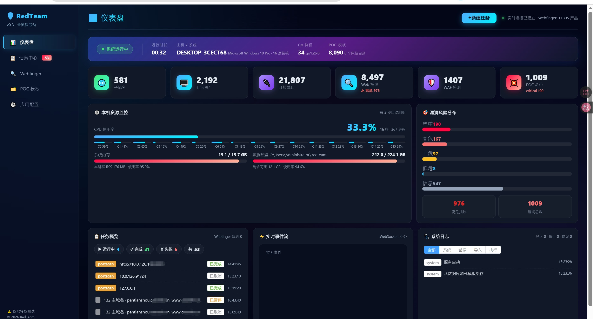
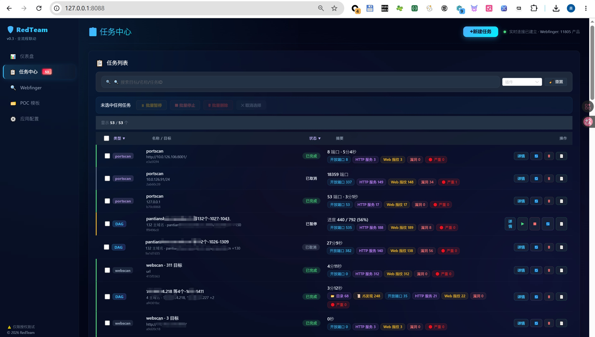
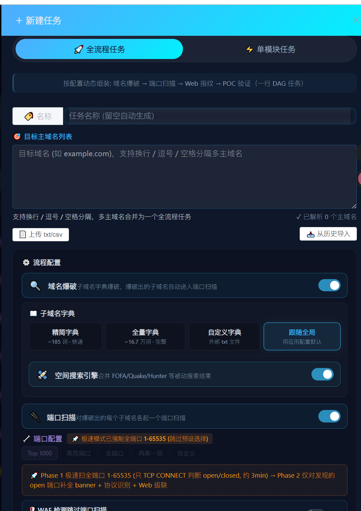
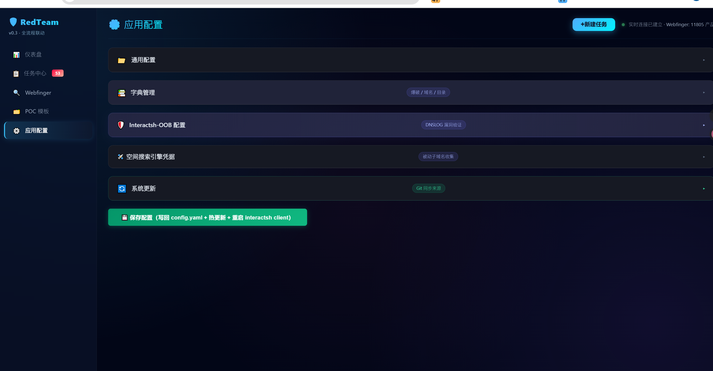
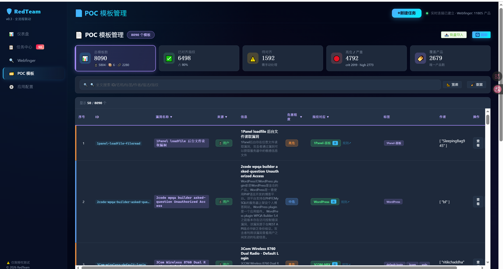
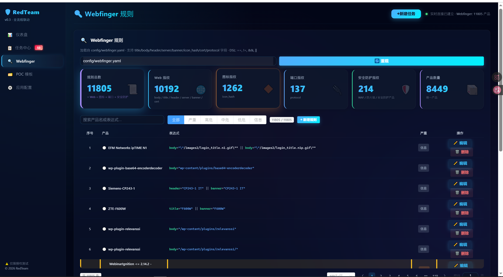
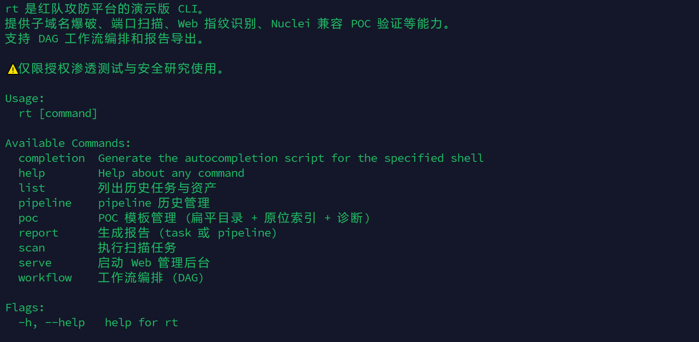

# rt-platform v1.1.1

> 企业内网自动化红队扫描平台 · 单模块 + DAG 流水线双模式 · 极速两段式端口扫描

---

## 🌐 Web 控制台

### 📊 仪表盘



实时资源监控 (CPU/内存/磁盘) · 任务概览 · 漏洞风险分布 (高危/中危/低危/信息) · 实时事件流 · 系统日志

### 📋 任务中心



单模块任务抽屉 · DAG 流水线预设 · 批量操作 (暂停/恢复/停止/重扫/删除) · 实时进度条 + 状态标签

### ⚡ 创建任务 — 极速/标准模式



portscan 单模块自动分两段: Phase 1 极速 TCP CONNECT 全端口 (秒级) → Phase 2 深度探测 banner+指纹+POC

### ⚙️ 应用配置



🌐 **随机 UA 池** (16 个主流浏览器 + Googlebot/Bingbot) · 字典管理 · OOB 关联 · 空间搜索引擎密钥 · 自动更新 — 点保存热生效, 无需重启

### 🎯 POC 模板管理



内置 148 套 + 自动更新 · 产品→模板手动 alignment + SmartMatch 智能匹配 Top5 · 相似度反查 · 模板预览/导入/导出

### 🧬 指纹 Webfinger 规则



YAML 规则 CRUD (name/severity/paths/methods/keyword/status) · 主动探测路径 · 严重性覆盖 · webfinger.yaml + active_finger.yaml 双通道

### 💻 命令行 CLI



```bash
# 单模块
rt.exe scan --plugin portscan --target 192.168.1.0/24

# DAG 流水线
rt.exe workflow --preset full_web --target http://example.com

# Web 控制台
rt.exe serve  # → http://localhost:8088
```

---

## 🚀 下载

| 平台 | 架构 | 下载 |
|------|------|------|
| Windows | amd64 | [rt-v1.1.1-windows-amd64.zip](https://gitee.com/tiaotiaohugogo/rt-platform-data/releases/download/v1.1.1/rt-v1.1.1-windows-amd64.zip) |
| Windows | arm64 | [rt-v1.1.1-windows-arm64.zip](https://gitee.com/tiaotiaohugogo/rt-platform-data/releases/download/v1.1.1/rt-v1.1.1-windows-arm64.zip) |
| Linux | amd64 | [rt-v1.1.1-linux-amd64.zip](https://gitee.com/tiaotiaohugogo/rt-platform-data/releases/download/v1.1.1/rt-v1.1.1-linux-amd64.zip) |
| Linux | arm64 | [rt-v1.1.1-linux-arm64.zip](https://gitee.com/tiaotiaohugogo/rt-platform-data/releases/download/v1.1.1/rt-v1.1.1-linux-arm64.zip) |
| macOS | Intel | [rt-v1.1.1-darwin-amd64.zip](https://gitee.com/tiaotiaohugogo/rt-platform-data/releases/download/v1.1.1/rt-v1.1.1-darwin-amd64.zip) |
| macOS | Apple Silicon | [rt-v1.1.1-darwin-arm64.zip](https://gitee.com/tiaotiaohugogo/rt-platform-data/releases/download/v1.1.1/rt-v1.1.1-darwin-arm64.zip) |
| 单文件 (Windows) | — | [rt.exe](https://gitee.com/tiaotiaohugogo/rt-platform-data/releases/download/v1.1.1/rt.exe) |

## 🏗️ 架构

```
rt.exe (embed 所有静态文件)
├── /api/*          Gin HTTP API (8088)
├── /ws/*           WebSocket 实时事件推送
├── /ui/*           Vue3 + Element Plus 前端 SPA
└── ~/.redteam/     SQLite 数据库 + POC + 字典 + Webfinger 规则
```

**扫描链路**:
```
portscan (fast_mode=true)
  ├─ Phase 1: 极速 TCP CONNECT (全端口, skip banner, 秒级)
  └─ Phase 2: runDeepScan → banner + 协议识别
                └─ cascadeWebScan → webscan.Run()
                     ├─ fingerprint.Run() (复用端口阶段 HTTP banner, 零额外请求)
                     └─ poc.Run()
                         ├─ products = cms + techs + products 三路合并
                         ├─ 精确匹配 loadProductTemplates(prod, excludeList)
                         ├─ 快速模式: 跳过 exclude_fingerprints 产品 + 同名变体去重
                         └─ 默认模式: 全量执行 + similar Top5 反查
```

## 📄 配置文件

首次启动自动生成 `~/.redteam/config.yaml`:

```yaml
server:
  host: 0.0.0.0
  port: 8088
scan:
  concurrency: 50
  timeout_seconds: 5
  random_ua_enabled: true       # 🌐 随机 UA 池开关
  random_ua:                    # 16 个默认浏览器 UA
    - Mozilla/5.0 Chrome/131.0.0.0 ...
    - ...
  exclude_fingerprints: []      # 快速模式剔除的产品 (Nginx/Tomcat 等)
poc:
  linked_dirs: []               # 自定义 POC 目录
interactsh:
  enabled: true                 # OOB 关联
passive:
  fofa_enabled: true
  fofa_key: ""
```

## 📜 License

内部使用, 严禁用于未经授权的系统。详见 [DISCLAIMER.md](DISCLAIMER.md)。

---

**v1.1.1 · 2026-10-27** · [Release 页面](https://gitee.com/tiaotiaohugogo/rt-platform-data/releases/v1.1.1)

**本次更新**: 随机 UA 池精致化 UI · portscan 模式卡片点击修复 · POC 轨迹全量未命中证据 · DAG CollectStepProducts 三 Bug 修复
